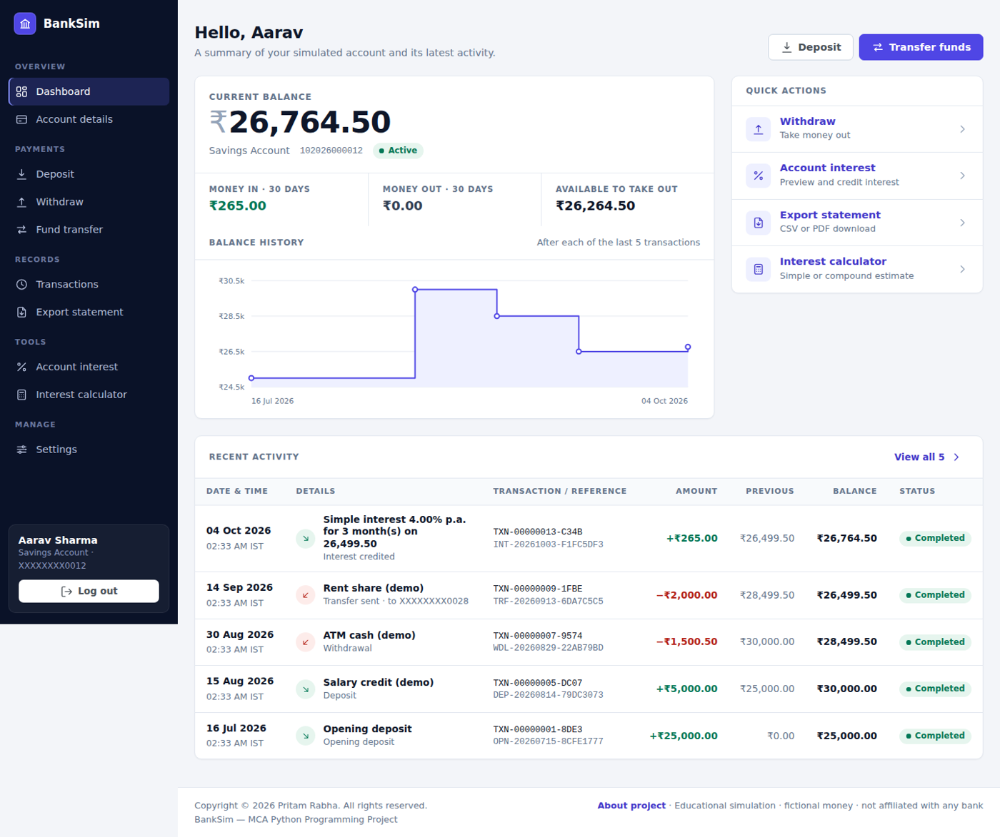
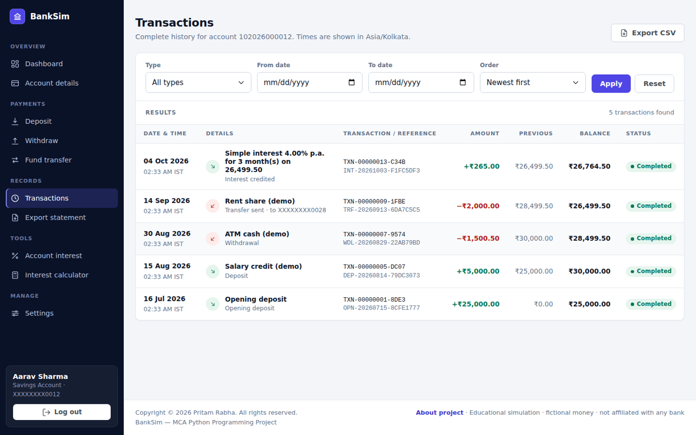

# BankSim — Bank Account Simulation

> **Educational simulation.** BankSim uses fictional money. It is **not** a real bank, implements no real banking product or regulation, is not affiliated with any bank, and must never be connected to real accounts or payment services.

A Flask web application that simulates savings, current and fixed-deposit accounts with a timestamped ledger, an interest calculator, PIN-based login, atomic fund transfers and statement export.


## Live demo

**Try BankSim:** [https://banksim-5hmn.onrender.com/](https://banksim-5hmn.onrender.com/)

> BankSim is an educational simulation that uses fictional money. Do not enter real banking credentials or connect real financial accounts.


## Author and academic details

| Field | Details |
|---|---|
| Application | BankSim — Bank Account Simulation |
| Author | Pritam Rabha |
| Programme | MCA, 3rd Semester |
| Course | Python Programming |
| Project guide | Dr. Pangambam Sendash Singh |
| Institution | Dr. Hari Singh Gour Vishwavidyalaya, Sagar, Madhya Pradesh |

## Contents

1. [Live demo](#live-demo)
2. [Author and academic details](#author-and-academic-details)
3. [Problem statement and objectives](#problem-statement-and-objectives)
4. [Features](#features-the-six-assignment-requirements)
5. [Technology stack](#technology-stack)
6. [Project structure](#project-structure)
7. [Installation](#installation)
8. [Demo accounts](#demo-accounts-fictional-when-seed_sample_datatrue)
9. [PIN configuration and security](#pin-configuration-and-security)
10. [Account-type rules](#account-type-rules-simulated)
11. [Interest formulas and assumptions](#interest-formulas-and-assumptions)
12. [Transfer processing](#transfer-processing)
13. [Transaction export](#transaction-export)
14. [User interface](#user-interface)
15. [Testing](#testing)
16. [GitHub](#github)
17. [Render deployment](#render-deployment)
18. [Credits and copyright](#credits-and-copyright)
19. [Data persistence limitations](#data-persistence-limitations-json-storage)
20. [Security considerations](#security-considerations-summary)
21. [Troubleshooting](#troubleshooting)
22. [Future improvements](#future-improvements)

## Problem statement and objectives

Learners need a safe way to practise the core logic of a banking application. Objectives: (1) model several account types with documented rules; (2) keep a complete, timestamped ledger; (3) calculate interest correctly with `Decimal`; (4) authenticate with hashed PINs and resist guessing; (5) move money between accounts so that a debit and credit can never be separated; (6) export statements safely; and (7) prove all of it with automated tests.

## Features (the six assignment requirements)

| # | Requirement | Implementation |
|---|---|---|
| 1 | Multiple account types | Savings, Current, Fixed Deposit; number, holder, type, opening date, balance, status; documented rules |
| 2 | Transaction history with timestamps | Every successful operation is a ledger entry; filters by type and date, newest-first/oldest-first, pagination |
| 3 | Interest calculation | Calculator (simple + compound, `Decimal`, formula shown, validated) and an account page that *credits* interest as a transaction |
| 4 | Secure PIN login | scrypt-hashed PINs, lockout after repeated failures, signed sessions, CSRF, logout, per-account URL authorisation |
| 5 | Fund transfer | Debit and credit committed in one all-or-nothing storage transaction under a lock; unique reference; confirmation page |
| 6 | Export history | CSV (required) and PDF (optional); own records only; masked account numbers; formula-injection protection |

Pages: Home, Dashboard, Register, PIN login, Account overview, Deposit, Withdraw, Fund transfer (+ confirmation), Interest calculator, Account interest, Transaction history, Export, Settings (change PIN / close account), About, Logout, custom error pages (400/403/404/405/429/500).

## Technology stack

Python 3.11+, Flask, Jinja2, HTML5/CSS3/JavaScript, Bootstrap 5.3.2 (self-hosted, with a custom design system on top), JSON file storage, `decimal.Decimal`, pytest, Gunicorn, GitHub + Render. Optional: ReportLab for PDF export.

## Project structure

```
Bank_Account_Simulation/
├── app/
│   ├── __init__.py          # app factory: CSRF, sessions, headers, error handlers
│   ├── config.py            # environment-driven settings (Decimal for money)
│   ├── routes.py            # all HTTP routes (one blueprint)
│   ├── services.py          # Bank: accounts, ledger, transfers, interest, auth, audit
│   ├── storage.py           # JsonStore: locking + atomic commit/rollback
│   ├── account_types.py     # documented account-type rules
│   ├── interest.py          # interest calculator (simple/compound)
│   ├── security.py          # PIN hashing, throttling, CSRF helpers
│   ├── exporter.py          # CSV / PDF export, formula-injection guard
│   ├── seed.py              # loads demo accounts
│   ├── utils.py             # validation / formatting helpers
│   ├── errors.py
│   ├── templates/           # Jinja2 templates (+ errors/)
│   └── static/{css,js,img,vendor/bootstrap}/   # self-hosted assets, no CDN
├── data/sample_accounts.json  # fictional demo accounts (bank_data.json is created at runtime)
├── tests/                   # pytest suite
├── scripts/audit_ledger.py  # ledger consistency checker
├── docs/PROJECT_REPORT.md
├── docs/screenshots/          # UI screenshots (desktop + mobile)
├── run.py                   # dev server
├── wsgi.py                  # production entry point
├── gunicorn.conf.py
├── render.yaml
├── pytest.ini
├── requirements.txt
├── requirements-dev.txt
├── .env.example
├── .gitignore
└── README.md
```

## Installation

### Ubuntu / Linux

```bash
sudo apt update && sudo apt install -y python3 python3-venv python3-pip git
cd Bank_Account_Simulation
python3 -m venv .venv
source .venv/bin/activate
pip install -r requirements-dev.txt

export SEED_SAMPLE_DATA=true SHOW_DEMO_CREDENTIALS=true   # optional demo accounts
python run.py                                              # http://127.0.0.1:5000
```

Production-style run (Linux/macOS): `SECRET_KEY=$(python -c "import secrets;print(secrets.token_hex(32))") gunicorn wsgi:app -c gunicorn.conf.py` (listens on port 8000).

### Windows (PowerShell)

```powershell
cd Bank_Account_Simulation
py -3.11 -m venv .venv          # or: python -m venv .venv
.\.venv\Scripts\Activate.ps1    # if blocked: Set-ExecutionPolicy -Scope Process RemoteSigned
pip install -r requirements-dev.txt

$env:SEED_SAMPLE_DATA="true"; $env:SHOW_DEMO_CREDENTIALS="true"
python run.py                   # http://127.0.0.1:5000
```

Gunicorn does not run on native Windows; use `python run.py` locally (or WSL). The Windows file-locking branch (`msvcrt`) is implemented but was **not** exercised in the build environment — the lock tests ran on Linux.

## Demo accounts (fictional, when `SEED_SAMPLE_DATA=true`)

| Holder | Type | Account number | PIN |
|---|---|---|---|
| Aarav Sharma | Savings | 102026000012 | 482916 |
| Diya Verma | Current | 202026000028 | 7391 |
| Kabir Singh | Fixed deposit (matured, interest credited) | 302026000034 | 260854 |
| Meera Das | Savings (closed) | 102026000046 | 905137 |

These PINs live only in `data/sample_accounts.json` as demo fixtures and are hashed when seeded; the data store never contains them. Turn `SHOW_DEMO_CREDENTIALS` off for anything other than a classroom demo.

## PIN configuration and security

* PIN is 4–6 digits (`PIN_MIN_LENGTH`/`PIN_MAX_LENGTH`); repeated (`1111`) or sequential (`1234`, `4321`) PINs are rejected.
* Stored only as a salted **scrypt** hash (Werkzeug). Optional `PIN_PEPPER` mixes a server-side secret in via HMAC-SHA256 before hashing. Changing the pepper invalidates every PIN.
* Hashes are never rendered or returned by any page/API (responses use a whitelist of public fields; tests assert this).
* **Throttling:** `MAX_FAILED_ATTEMPTS` (default 5) wrong PINs on an account within 15 minutes lock that account's authentication for `LOCKOUT_MINUTES` (15); `IP_MAX_FAILED_ATTEMPTS` (20) does the same per client IP. While locked even the correct PIN is refused (HTTP 429 + `Retry-After`). Counters are stored in the data file so restarts don't reset them. Wrong PINs on transfer/settings count too.
* **Sessions:** signed Flask cookie, `HttpOnly`, `SameSite=Lax`, `Secure` in production, 15-minute idle timeout, session reset on login, and sessions older than a PIN change are rejected.
* **CSRF:** every POST needs a per-session token (form field or `X-CSRFToken`), compared in constant time.
* **Authorisation:** URLs contain the account number, but it must equal the signed-in account or the answer is `403` (identical for non-existent accounts, so no enumeration).
* Transfers and account closure re-ask for the PIN (step-up).
* Headers: CSP restricted to `'self'` (no external hosts), `X-Frame-Options: DENY`, `nosniff`, `Referrer-Policy`, `Cache-Control: no-store`, HSTS in production.

> **Educational authentication simulation.** A short numeric PIN is **not** adequate as the only protection for an internet-facing production financial service: the 10,000–1,000,000 PIN space can be brute-forced offline if a hash leaks, and account lockout can itself be abused to lock out a victim. Real systems use strong credentials, multi-factor authentication, device/risk checks, monitoring and regulatory compliance.

## Account-type rules (simulated)

| | Savings | Current | Fixed Deposit |
|---|---|---|---|
| Minimum opening deposit | 500.00 | 1,000.00 | 1,000.00 |
| Minimum balance kept | 500.00 | 0 (no overdraft) | — |
| Interest | 4.00% p.a. simple (configurable) | 0% (configurable) | by term: 6m 6.00, 12m 6.50, 24m 6.75, 36m 7.00, 60m 7.25 |
| Deposits / transfers in | yes | yes | **no** |
| Withdrawals / transfers out | yes (above minimum) | yes | **only after maturity** |
| Closing | any time (balance paid out) | any time | only after maturity |

All amounts are in simulated ₹, with at most 2 decimals, and each transaction is capped at `MAX_TRANSACTION_AMOUNT` (1,000,000.00). A closed account can still log in to view and export history, but every money operation is refused.

## Interest formulas and assumptions

* **Simple:** `I = P × R × T ÷ 100`, `A = P + I`
* **Compound:** `A = P × (1 + R ÷ (100·n))^(n·T)`, `I = A − P` (n = 1, 2, 4 or 12)
* P principal, R annual rate %, T years (months ÷ 12).

Inputs: principal 0.01–1,000,000,000.00; rate 0–100 (≤ 4 decimals); time > 0 up to 100 years (≤ 2 decimals), in years or months. Negative, zero (where meaningless), malformed and over-precise values are rejected server-side.

**Estimated ≠ credited.** The calculator and the "preview" on the account Interest page never change a balance; they are labelled *Estimate — not credited*. Interest is credited only by the explicit confirm button, which writes an `INTEREST_CREDIT` transaction:

* **Savings / Current (if rate > 0):** *simple* interest on the **current balance** for 1–12 months chosen by the user — a simulated time step, so a user could credit repeatedly; this is a teaching shortcut, not how real banks work.
* **Fixed deposit:** simple interest on the principal for the **whole term**, once, after maturity: `Principal × Rate × Months ÷ 1200`.

Assumptions/limits: 12 equal months per year; constant rate; no tax, fees or penalties; no leap-year/day-count conventions; fractional compounding periods use a fractional exponent; only the final figure is rounded (half-up to 0.01).

## Transfer processing

1. The signed-in account is the source; the user enters the destination number, amount, optional note and re-enters the PIN.
2. Inside **one** `store.transaction()`: duplicate-key check → PIN check → destination exists → source open, FD unlocked, available balance (balance − minimum) ≥ amount → destination open and accepts deposits → debit and credit posted with a shared `TRF-YYYYMMDD-XXXXXXXX` reference.
3. Leaving the block writes the new state with a single atomic file replacement. Any exception (validation, a crash between the debit and the credit, or a disk error) discards the in-memory changes, so **both or neither** entry exists. Tests inject a failure between the two steps and a failing `os.replace` and confirm balances and ledger are unchanged.
4. Duplicate submissions are neutralised by a per-form idempotency key (scoped to account + operation) and a JavaScript double-click guard.
5. A confirmation page shows the reference, masked accounts, timestamp and balances.

## Transaction export

`Export` page → CSV (or PDF if ReportLab is installed), filtered by type, dates and order. Columns: masked account number, transaction ID, type, local date/time, UTC ISO timestamp, direction, amount, previous balance, new balance, reference, masked counterparty, description, status. Only the signed-in account's records can be exported (another account's URL gives 403). Filters are validated (bad values → 400 with messages); an empty result shows a message instead of an empty file. File names look like `BankSim_statement_acct-0028_from-2026-01-01_to-2026-03-31.csv`. **Formula injection:** any cell beginning with `= + - @`, tab or CR (also after leading spaces) is prefixed with `'`. The CSV has a UTF-8 BOM so Excel displays non-ASCII names.

## User interface

A banking-console style interface rather than a stock template: a fixed navy sidebar (grouped navigation, account block, log out) with a slide-out drawer on phones; page headers with actions; a balance panel with 30-day money in/out and a step-line balance-history chart (inline SVG, no JavaScript library); dense ledger tables with tabular figures, signed colour-coded amounts and status pills; payment forms with a live account-summary side panel; split-screen sign-in/registration; Indian digit grouping (₹12,34,567.89); keyboard-focus styles, labelled inputs and ARIA attributes throughout.

Bootstrap 5.3.2 (grid, forms, utilities, alerts) is **self-hosted** in `app/static/vendor/bootstrap/` (MIT; it is the Bootswatch compiled build, whose colours, typography and components are overridden in `static/css/style.css`). There is no CDN dependency, so the page works offline and the Content-Security-Policy allows only `'self'`. To use stock Bootstrap instead, replace the two vendored files.

| Dashboard | Transactions |
|---|---|
|  |  |

More in `docs/screenshots/` (login, register, landing, fund transfer, interest calculator, mobile).

**What was verified visually:** every page was rendered in headless Chromium at 1440 px and 390 px wide; no console errors; no horizontal overflow on any page at 390 px (checked programmatically); the mobile drawer opens and closes. **Not verified:** Safari/Firefox/Edge, real phones, or a screen reader — the system font stack means text will look slightly different on your machine than in the screenshots.

## Testing

```bash
pip install -r requirements-dev.txt
pytest            # runs tests/ using pytest.ini
```

The suite uses an isolated temporary data file per test and covers account types, PIN hashing/verification, throttling, unauthorised access, deposits/withdrawals, insufficient balance, interest, transfers, same-account rejection, atomicity, closed accounts, history/filters/pagination, CSV export, formula injection, CSRF, JSON persistence, concurrency and invalid input.

**Recorded result from the build environment:** 256 test cases (141 test functions, parametrised) — **256 passed, 0 failed**. Important caveat: the build sandbox had no network, so the real `pytest` package could not be installed; the run used a small stand-in test runner that supports the pytest features the suite uses (fixtures, `tmp_path`, `monkeypatch`, `raises`, `parametrize`). Please run real `pytest` on your machine and treat that as the authoritative result. The stand-in is not included in the project. `gunicorn` was also unavailable in the sandbox, so `gunicorn.conf.py` and `render.yaml` were syntax-checked but the Gunicorn start-up itself was not run; the app was run with `python run.py` and exercised over HTTP (login, deposit, transfer, 403, CSRF 400, CSV download), and the interface was rendered and inspected in headless Chromium (see *User interface* below).

Extra check: `python scripts/audit_ledger.py` verifies balance/ledger consistency of `data/bank_data.json`.

## GitHub

```bash
git init
git add .
git commit -m "BankSim: MCA Python Programming project"
git branch -M main
git remote add origin https://github.com/<your-username>/Bank_Account_Simulation.git
git push -u origin main
```
`.gitignore` excludes `.venv`, `.env`, caches and the runtime data file.

## Render deployment

1. Push to GitHub.
2. Render dashboard → **New → Blueprint** → select the repository (reads `render.yaml`), or create a **Web Service** manually with build `pip install -r requirements.txt` and start `gunicorn wsgi:app -c gunicorn.conf.py`.
3. `SECRET_KEY` and `PIN_PEPPER` are generated by Render. `BANKSIM_ENV=production` makes a missing `SECRET_KEY` a startup error.
4. Open the service URL; `/healthz` is the health check. `SEED_SAMPLE_DATA`/`SHOW_DEMO_CREDENTIALS` are on in the blueprint for demos — turn them off otherwise.
5. **Free plan storage is ephemeral:** the JSON file disappears on restart/redeploy (demo accounts are re-seeded). For persistence use a paid plan with a disk and `DATA_FILE=/var/data/bank_data.json`.

## Data persistence limitations (JSON storage)

* Every commit rewrites the whole file — fine for a demo, slow at scale.
* Atomicity relies on a thread lock + OS file lock + atomic replace. That gives all-or-nothing transfers **on one machine with a local filesystem**. It provides no write-ahead log, replication, or point-in-time recovery (only one `.bak` copy of the previous version).
* Do not put the file on a network share, and do not run several app instances on different hosts against it.
* A power cut during `fsync`/replace leaves either the old or the new file, never a half-written one, but a crash can lose the most recent commit.
* For anything beyond a classroom, use a transactional database such as PostgreSQL (`SELECT … FOR UPDATE` / a DB transaction replaces `JsonStore.transaction`).

## Security considerations (summary)

Educational model only. No rate limiting on registration; no email/MFA/recovery flow; session cookies cannot be revoked server-side except by the PIN-change rule; lockout can be used to annoy a victim; HTTPS must be provided by the host (Render does). Never reuse real PINs.

## Troubleshooting

| Problem | Fix |
|---|---|
| `RuntimeError: SECRET_KEY must be set` | You set `BANKSIM_ENV=production`; also set `SECRET_KEY`. |
| Logged out on every restart / with several workers | Set a fixed `SECRET_KEY`. |
| Page unstyled | Hard-refresh (Ctrl+F5); confirm `app/static/vendor/bootstrap/` and `app/static/css/style.css` exist (they are served locally, no internet needed). |
| `Data file … is corrupted` | Stop the app, inspect `data/bank_data.json`, restore `data/bank_data.json.bak`, restart. |
| Demo accounts missing | Set `SEED_SAMPLE_DATA=true` and start with an empty/absent data file. |
| Account locked | Wait `LOCKOUT_MINUTES` (default 15) or delete `data/bank_data.json` in a demo. |
| "Security check failed" (400) | The form page expired or cookies are blocked; reload and retry. |
| Dates look off by hours | Times are stored in UTC and displayed in `DISPLAY_TIMEZONE` (default Asia/Kolkata). |
| PDF option missing | `pip install reportlab`. |
| Activation blocked on Windows | `Set-ExecutionPolicy -Scope Process RemoteSigned`. |
| `ModuleNotFoundError: app` when running pytest | Run from the project root (`pytest.ini` sets `pythonpath = .`). |

## Future improvements

Migrate to PostgreSQL/SQLite with SQLAlchemy; real multi-factor and passkey login; account-holder profiles with several accounts per login; scheduled interest posting; standing instructions; admin/audit role; rate limiting on registration; i18n; richer charts; PDF with a proper Unicode font (₹).

## Credits and copyright

**Project:** BankSim — Bank Account Simulation  
**Developer and author:** Pritam Rabha  
**Academic context:** MCA, 3rd Semester — Python Programming  
**Institution:** Dr. Hari Singh Gour Vishwavidyalaya, Sagar, Madhya Pradesh  
**Live demo:** [https://banksim-5hmn.onrender.com/](https://banksim-5hmn.onrender.com/)

Copyright © 2026 Pritam Rabha. All rights reserved.

This project was created for educational and academic purposes. The application simulates banking operations using fictional data and is not a real banking service. Please refer to the security and educational-use notices above before using the live demo.
